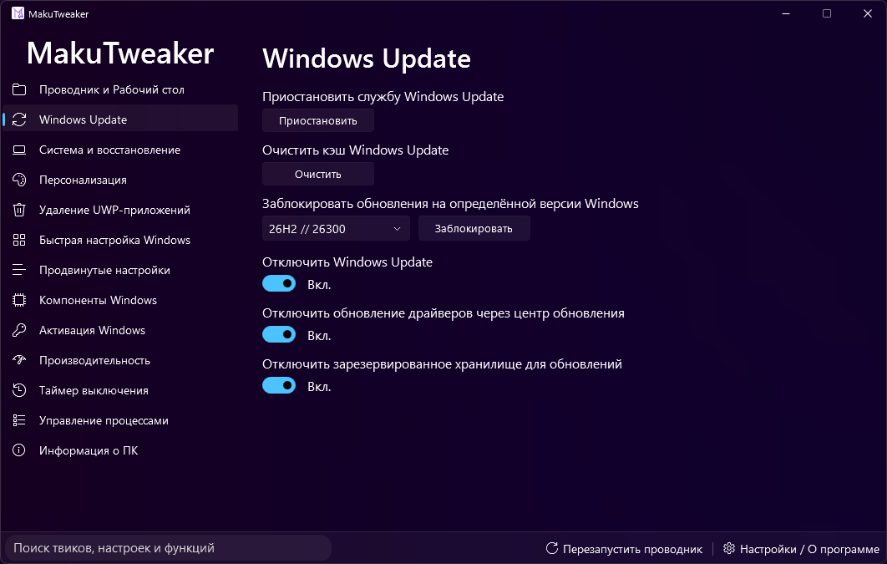
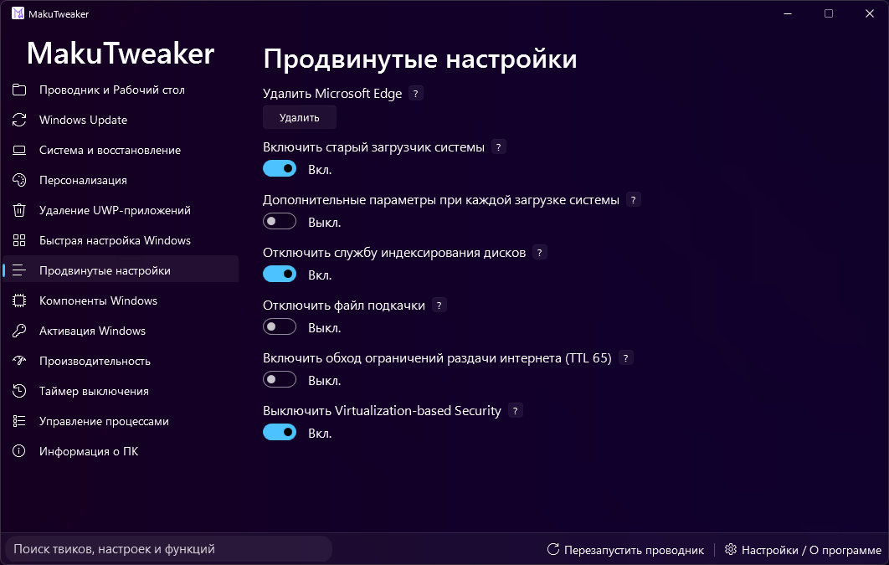
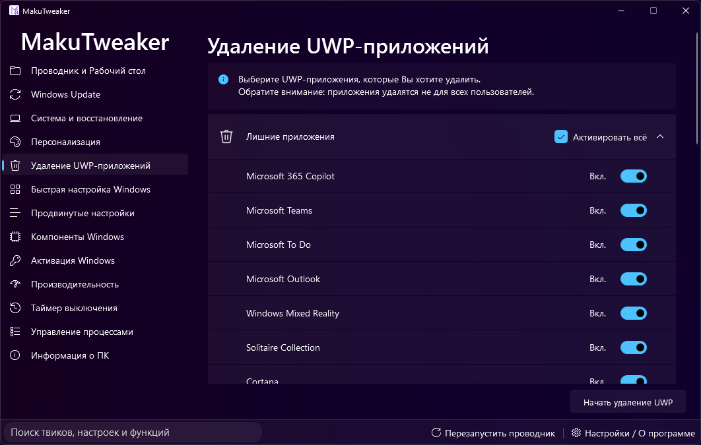
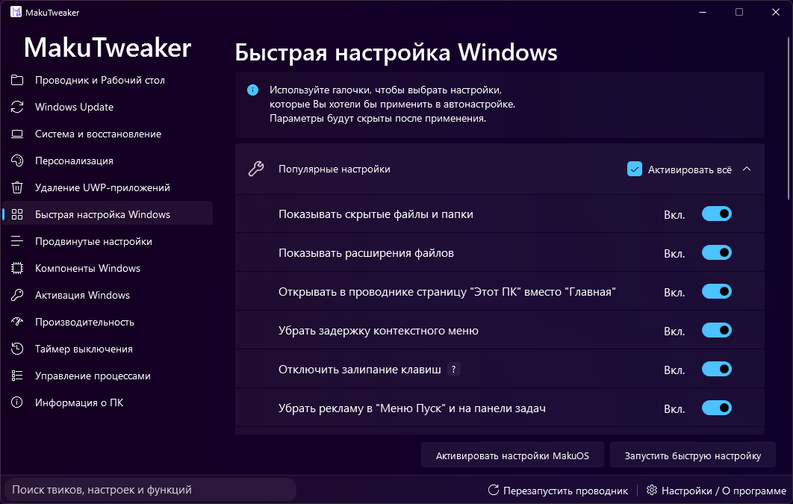
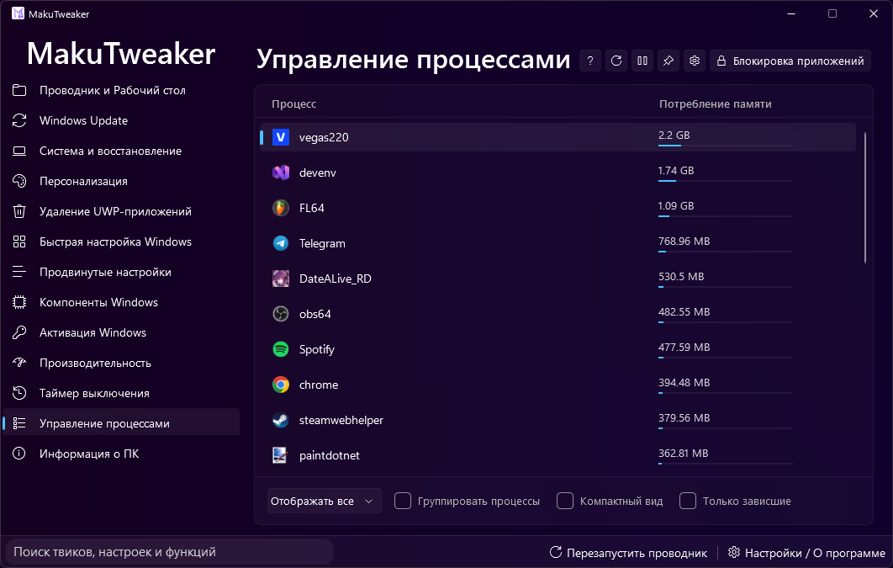

# MakuTweaker: Modular Windows System Tweaking & Configuration Tool – Windows 10 & 11

### 💻 PowerShell Installer

   

---

MakuTweaker is a Windows desktop utility that provides flexible system configuration, personalization, process management, and detailed hardware inspection through a single native interface. Built on the .NET 8.0 platform and developed in Visual Studio 2022, it delivers quick system setup routines, management of system component installation, and removal of preinstalled bloatware. The application offers multiple interface themes and uses the MicaWPF framework to integrate closely with the Windows 11 design language. Administrator rights are required for correct operation within the IDE, and the project must be built before forms are first opened in the visual designer.

## ✅ Requirements

- **PowerShell 5.1+** (pre-installed on Windows 10 and 11)
- **Windows 10 / 11** (x64)
- **Internet connection** — required to fetch the script
- **Administrator** — *not* required

## Features

MakuTweaker provides a centralized environment for system configuration, process management, and hardware inspection on Windows. The feature set is organized around the following capability areas:

- **System customization and personalization.** Adjust a broad range of Windows settings through a unified interface, applying configuration changes without navigating disparate native utilities.
- **Process management.** Inspect and control running processes directly from the application, with the ability to review activity and manage execution state.
- **Hardware and system information.** View detailed specifications about the host machine, including component-level reporting suitable for diagnostics and inventory purposes.
- **Quick system setup.** Apply a streamlined configuration workflow to prepare a Windows installation with preferred settings in a reduced number of steps.
- **Component installation management.** Manage the installation of system components through a controlled, guided process.
- **Bloatware removal.** Identify and remove unwanted preinstalled system content to reduce footprint and background overhead.
- **Theming.** Select from multiple interface themes to adapt the application's appearance to individual preference.
- **Windows 11 design integration.** The interface is built on the MicaWPF framework, delivering full alignment with the Windows 11 design language, including Mica material behavior.
- **Open source codebase.** The full source is available for community review, contribution, and extension.
- **Modern .NET platform.** Developed in Visual Studio 2022 and running on .NET 8.0, providing current runtime performance and tooling support.
- **Administrator-aware operation.** The application operates with the elevated privileges required for correct system-level configuration, including when run within an IDE.

Note: the Windows Activation page is not included in this source release for legal reasons.

## How it works

MakuTweaker operates as a native Windows desktop application built on the .NET 8.0 runtime and rendered through the MicaWPF framework, which supplies the Mica backdrop, accent-aware brushes, and window chrome that align the interface with the Windows 11 design language. The application launches as a single process with an elevated token, a requirement driven by the depth of system-level operations it exposes.

Internally, the program is organized around a modular page architecture. Each functional area — system personalization, process management, hardware inventory, quick setup, component installation, and cleanup — is implemented as an independent module that is loaded into the shared shell on demand. This separation keeps startup cost low and allows individual modules to be maintained or extended without affecting the rest of the application. A central navigation host coordinates module switching, while a theme service propagates the selected visual theme across every loaded view at runtime.

System configuration is applied through controlled writes to registry hives and documented Windows management interfaces. Rather than issuing raw changes directly, the application routes each tweak through a dedicated handler that validates the current system state, records the prior value, and applies the modification in a single transaction-like sequence. This design allows every applied change to be reversed from within the application, restoring the captured original state. Handlers are grouped by subsystem so that related tweaks can be applied or rolled back as a unit.

Process and hardware inspection rely on native Windows APIs queried at runtime. The process module enumerates running processes, exposes per-process resource usage, and supports termination and priority adjustment. The hardware module aggregates processor, memory, storage, and graphics information into a unified view, refreshing on page activation rather than polling continuously.

Quick setup and component management are driven by declarative configuration files bundled with the application. Each entry defines the target component or task, its prerequisites, and the operations required to complete it. The execution engine reads these definitions, resolves dependencies in order, and reports progress back to the interface. Cleanup operations follow the same model, scanning known locations and presenting candidates for review before any removal occurs.

The codebase is structured for development in Visual Studio 2022. Because the visual designer depends on compiled assemblies to resolve custom controls and theme resources, the project must be built once before forms are opened in the editor for the first time; otherwise the designer surface will render without the MicaWPF elements. Running or debugging within the IDE requires administrator privileges, matching the elevation the application demands at runtime.

## Compatibility

MakuTweaker is engineered for the Windows desktop environment and ships as a .NET 8.0 application, so it runs natively on any Windows system with the .NET Desktop Runtime installed. The solution is maintained in Visual Studio 2022; building from source requires the matching SDK and the Windows desktop development workload.

Because the application performs system-level tweaks, process management, and component installation, it must be launched with administrator privileges. Standard user contexts will be rejected or will silently fail on protected operations. When running from the IDE, the same elevation requirement applies, so the debugger must be attached to an elevated process.

The interface layer is built on the MicaWPF framework and is optimized for full visual integration with Windows 11. On Windows 10 or under unsupported configurations, Mica effects degrade gracefully to standard window rendering while all functional features remain available. High-DPI displays, multi-monitor setups, and light/dark theme switching are supported through the same framework.

Compatibility notes for source builds:
- Build the project before opening any forms in the visual designer for the first time, so that the designer cache populates correctly and all controls render as expected.
- The Designer has been validated against the Visual Studio 2022 toolchain; older IDE versions may fail to resolve MicaWPF resources.
- System components written or removed by MakuTweaker are version-gated to their respective Windows builds; the tweaker detects and disables unsupported actions rather than applying them.
- The "Windows Activation" page is intentionally absent from this source distribution for legal reasons and will not appear in any build configuration.

## 📸 Screenshot

## FAQ

**Which Windows versions are supported?**
MakuTweaker targets Windows 10 and Windows 11. Full visual integration — including Mica backdrop effects and native window styling — relies on the MicaWPF framework and is therefore only available on Windows 11. On Windows 10, the application remains fully functional but falls back to standard window rendering.

**Which .NET version is required?**
The project is built on .NET 8.0. Building from source requires the corresponding SDK, while running a compiled build requires the .NET Desktop Runtime 8.0 or later.

**Why does the application request administrator privileges?**
System-level operations — modifying registry keys, managing processes, and installing or removing system components — require elevated permissions. The application must be launched with administrator rights for these features to function correctly, and the same applies when debugging within the IDE.

**Why does the visual designer fail to display elements correctly in Visual Studio?**
The designer depends on a compiled cache to resolve custom controls and resources. Build the project first before opening any form in the editor; otherwise, elements may render incorrectly or fail to load.

**Are the tweaks reversible?**
Every tweak applies a defined, documented system change. Most modifications can be reverted through the application itself by restoring the corresponding default value. It is strongly recommended to create a system restore point before applying bulk optimizations or removing system components.

**Why is the Windows Activation page missing from the source code?**
The activation page has been excluded from this source release for legal reasons. It is not present in the codebase and cannot be restored by building the project.

**Can I contribute to the project?**
Yes. MakuTweaker is open source and contributions are welcome. Fork the project, create a feature branch, and submit a pull request describing the change. Please keep code style consistent with the existing codebase and verify that the solution builds cleanly before submitting.

**How do I report a bug or request a feature?**
Use the issue tracker of the project to describe the problem or suggestion. Include your Windows version, the .NET runtime version, and steps to reproduce the issue — this significantly speeds up diagnosis and resolution.

## Disclaimer

MakuTweaker is provided as open-source software under the terms of its license, and is distributed on an "as is" basis, without warranties or guarantees of any kind, whether express or implied, including but not limited to fitness for a particular purpose, merchantability, or non-infringement. By using, compiling, or modifying this software, you acknowledge that you do so entirely at your own risk.

The application performs privileged operations, including system configuration changes, process management, and modification of installed Windows components. These operations require administrator rights and may alter system settings, registry values, services, scheduled tasks, or installed packages. Such modifications may not be fully reversible and may affect system stability, application compatibility, or the behavior of security software. You are solely responsible for evaluating each feature before applying it, for maintaining current backups of your system and data, and for verifying that any change is appropriate for your environment.

No responsibility is accepted for data loss, system instability, hardware or software damage, reduced performance, or any direct, indirect, incidental, special, or consequential damages arising from the use, misuse, or inability to use this software, even if advised of the possibility of such damages. This limitation applies to the source code, to any builds produced from it, and to any derivative works created by third parties.

The absence of certain functionality in this version of the source code does not constitute an endorsement of equivalent functionality obtained elsewhere. Features omitted from the codebase are excluded deliberately and should not be reintroduced, redistributed, or substituted through third-party modifications.

This software is not affiliated with, endorsed by, or sponsored by Microsoft Corporation or any other vendor referenced by the operating system it targets. All trademarks and product names remain the property of their respective owners and are used solely for descriptive purposes.

You are responsible for compliance with all applicable local laws and regulations, as well as with any agreements governing the systems on which the software is run. If you do not accept these terms, do not use, compile, or distribute the software.

## License

MakuTweaker is distributed under the MIT License, a permissive open-source license that grants broad rights to use, copy, modify, merge, publish, distribute, sublicense, and sell copies of the software and its associated documentation.

Under the terms of this license, the copyright notice and permission notice must be included in all copies or substantial portions of the software. The software is provided "as is", without warranty of any kind, express or implied, including but not limited to the warranties of merchantability, fitness for a particular purpose, and noninfringement.

Because MakuTweaker performs system-level modifications on Windows, downstream users and integrators are responsible for validating behavior in their own environments. In no event shall the authors or copyright holders be liable for any claim, damages, or other liability arising from, out of, or in connection with the software or its use.

The source code is made available to the community to encourage review, contribution, and derivative development. Contributions submitted to the project are accepted under the same license terms, ensuring that the codebase remains consistently open and redistributable. The absence of certain features in the published source, where noted elsewhere in this document, does not alter the licensing terms governing the remainder of the project.